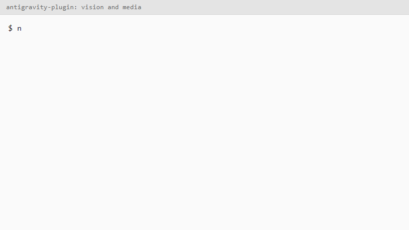

<div align="center">

# antigravity-plugin

Delegate code reviews, second opinions, fixes, screenshots, and audio/video analysis to Google's Antigravity CLI (agy) from Claude Code, Codex CLI, agy, or your shell.

[npm](https://www.npmjs.com/package/@southcarpet/antigravity-plugin) · [Releases](https://github.com/SouthCarpet/antigravity-plugin/releases) · [Changelog](./CHANGELOG.md) · [Commands](./docs/COMMANDS.md) · [Security](./SECURITY.md)

[](https://www.npmjs.com/package/@southcarpet/antigravity-plugin)
[](https://github.com/SouthCarpet/antigravity-plugin/actions/workflows/ci.yml)
[](https://github.com/SouthCarpet/antigravity-plugin/releases)
[](./LICENSE)
[](./package.json)
[](https://github.com/SouthCarpet/antigravity-plugin/issues?q=is%3Aissue+is%3Aopen+label%3A%22known+issue%22)
[](https://socket.dev/npm/package/@southcarpet/antigravity-plugin/overview/)

</div>

## What it is

- Runs `agy --print` from the host you already use.
- Gives Claude Code, Codex CLI, agy, and the standalone CLI the same ten verbs.
- Reviews diffs, runs delegated prompts, analyzes named images and media, and manages background jobs.
- Works with agy, the CLI that took over from Gemini CLI for free and personal Google accounts. If you used a Gemini CLI plugin before, install agy and this plugin.

<picture>
  <source media="(prefers-color-scheme: dark)" srcset="https://raw.githubusercontent.com/SouthCarpet/antigravity-plugin/main/assets/demo/media-vision-dark.gif">
  <source media="(prefers-color-scheme: light)" srcset="https://raw.githubusercontent.com/SouthCarpet/antigravity-plugin/main/assets/demo/media-vision-light.gif">
  
</picture>

Output from real runs of the 3.2.0 release code. Waiting time and some lines are cut.

## New in 3.2.0

- **Pick a model by family.** `--model-alias flash|argon|pro|sonnet|opus|gpt-oss` selects the newest matching model from your account's `agy models` list.
- **Get a second opinion.** `review --models <a,b> --findings-json` runs the same review with two models and shows which findings both found and which only one found.
- **Look before you spend quota.** `--preview` on task, rescue, vision, and media shows the exact request with no agy call and no download.
- **Keep transcripts and answers.** `media --transcript --timestamps` adds `[HH:MM:SS]` to each caption line, and `media --output <path>` saves the answer to a new file.
- **Check old reviews.** `result --check-current` tells you if a stored review still matches your diff, and `result --export <path>` saves the stored record for another host.
- **Better bug reports.** `doctor --receipt` prints a short compatibility receipt with no paths and no account data.
- **Quieter Windows.** Background jobs open no console windows, and Ctrl+C in a foreground run stops agy.

All changes: [CHANGELOG](./CHANGELOG.md).

## Installation and quick start

### Claude Code

```bash
claude plugin marketplace add SouthCarpet/antigravity-plugin
claude plugin install antigravity@antigravity
/antigravity:setup
/antigravity:review
```

### Codex CLI

```bash
codex plugin marketplace add <path-to-clone>
codex plugin add antigravity@antigravity
$antigravity setup
$antigravity review
```

### agy

```bash
git clone https://github.com/SouthCarpet/antigravity-plugin.git
cd antigravity-plugin
node scripts/pack-for-agy.mjs
# Run the printed agy plugin install command, then restart agy.
# In the agy TUI:
/antigravity:<verb>
```

### Standalone

```bash
# Run from any shell:
npx @southcarpet/antigravity-plugin setup
npx @southcarpet/antigravity-plugin doctor
npx @southcarpet/antigravity-plugin review
```

If a command fails, see [Troubleshooting](./docs/INSTALL.md#troubleshooting).

## Status

> **v3.2.0.** From 3.0.0, while the first number stays 3, an update
> does not break a command or output that already works. Removals are first
> marked deprecated, stay for at least one more 3.x minor release, and happen
> only in 4.0.0. See [`docs/COMPATIBILITY.md`](./docs/COMPATIBILITY.md).

- 3.0.0 changed one default: `vision` now uses `gemini-3.8-flash-high`. Pass `--model gemini-3.6-flash-high` to keep the old model. See [`CHANGELOG.md`](./CHANGELOG.md).
- Plugin 3.2.0 is this package's version. agy is Google's Antigravity CLI, and its version moves separately.
- Measured agy versions span 1.1.15 to 1.5.3, newest measured 1.5.3. Coverage differs by version; see [Compatibility](./docs/COMPATIBILITY.md).
- The plugin does not update itself.
- Version numbers: **Y** in `X.Y.Z` changes for new features and larger compatible updates. **Z** changes for fixes; **X** changes only for breaking changes.

## Why this plugin

- **One command set on every host.** The same ten verbs run everywhere.
- **Clear failures.** Denied actions are reported with a remedy. An empty answer with a denied action fails.
- **Real image input.** `vision` sends pixels to agy, and `--expect` checks the transcription for text you name.
- **Reviews you can check.** `review` can preview its input, return schema-checked findings, check cited lines against the diff, and compare two models.
- **Background jobs.** `status`, `result`, and `cancel` manage them, and `--request-id` prevents double dispatch. Worker crashes leave a safe diagnostic in the job log.
- **Predictable runs.** `task` and `rescue` have a default effort and a time budget, and every job records its provenance.
- **Script-friendly.** `--json` writes one envelope, also for expected failures.
- **Small.** No runtime dependencies, a read-only `doctor`, CI on three systems, and releases with npm provenance and signed tags.

Flags, defaults, and exit codes: [Commands reference](./docs/COMMANDS.md). Measured limits: [Compatibility](./docs/COMPATIBILITY.md).

## How it works

- Your host or shell calls the plugin, which runs `agy --print`. agy talks to Google's service.
- `vision` uses a local MCP server that hands agy only the images you named. If agy offloads a large image, the prompt opens only that exact copy.
- Prompts, selected diffs, image bytes, and files agy reads with its own tools can reach Google's service.
- Job records stay on your machine. `status`, `result`, and `cancel` never call the model.
- If agy denies an action, the plugin reports the action, its target when known, and a remedy. Your host asks you what to do, or reports and stops.
- `setup` writes user-level files under `~/.gemini`, never the repository.

## Commands

| Verb | Purpose |
|---|---|
| `setup` | Run the agy OAuth probe and configure or remove the vision channel. |
| `review` | Review a working-tree or branch diff. |
| `rescue` | Delegate a prompt in a fresh or resumed conversation. |
| `task` | Run a delegated prompt, in the background by default. |
| `media` | Analyze local audio/video or one YouTube video. |
| `vision` | Analyze one or more named image files. |
| `status` | List jobs or inspect and wait for one job. |
| `result` | Read the stored result for a job. |
| `cancel` | Stop a queued or running job. |
| `doctor` | Read-only environment check. No OAuth, model call, write, or network. |

`update` is a standalone convenience command, not one of the ten verbs. Flags and exit codes: [Commands reference](./docs/COMMANDS.md).

Model choice also supports `--model-alias flash|argon|pro|sonnet|opus|gpt-oss`
on task, rescue, review, vision, and media. It selects from this account's
`agy models` listing. Exact `--model` remains unchanged.
See [Model aliases](docs/COMMANDS.md#model-aliases).

## Vision

- `agy --print` has no native image input, so a local MCP server delivers the pixels.
- Answers have `Transcription`, `Observations`, and `Answer` sections. If images cannot be delivered, the answer is `VISION-UNAVAILABLE: <reason>`.
- An answer from this channel is not evidence. Cross-check the transcript.
- The default model is `gemini-3.8-flash-high` (before 3.0.0: `gemini-3.6-flash-high`).
- Formats, limits, and flags: [Commands reference](./docs/COMMANDS.md#vision).

```bash
npx @southcarpet/antigravity-plugin vision ./screenshot.png --prompt "Which text is visible?"
```

## Media

Send a local audio or video file with `media ./clip.mp4`. agy opens the exact file with `read_file` (measured on agy 1.5.0, 1.5.1, and 1.5.3), with `--add-dir` limited to its directory. The whole directory of the file is readable for the run; keep unrelated files out of it. Media bytes reach Google. For YouTube, yt-dlp downloads the file first, then that file reaches Google.

YouTube needs yt-dlp on PATH (`winget install yt-dlp.yt-dlp` or `py -m pip install --user yt-dlp`). Merging video formats needs ffmpeg. Default quality is 360p; use `--quality 480p`, `--quality 720p`, `--audio`, or `--transcript`. Transcript-only mode prints captions without a model call; add `--timestamps` for `[HH:MM:SS]` prefixes, or `--prompt` to ask about them. `--output <path>` saves the answer text to a new file and never overwrites. Downloads are deleted after the job unless `--keep`. Local files have a 100,000,000-byte cap. The default model matches vision: `gemini-3.8-flash-high`.

`media ./speech.wav --expect pineapple --json`

Full flags, supported extensions and errors: [Media reference](./docs/COMMANDS.md#media).

## Updating

- **Standalone:** use an unversioned `npx @southcarpet/antigravity-plugin <command>`. A pinned version does not update.
- **Claude Code:** `claude plugin marketplace update antigravity`, then `claude plugin update antigravity@antigravity`, then restart.
- **Codex CLI:** `codex plugin remove antigravity@antigravity`, then `codex plugin add antigravity@antigravity`. Pull your local clone first if the marketplace is one.
- **agy:** `agy plugin uninstall antigravity`, then reinstall from a fresh packed copy. See [Installation](./docs/INSTALL.md#agy-itself).
- **Helper:** `antigravity-plugin update` checks the npm registry and prints the commands for the hosts it finds.
  - `update --apply` runs them. For Claude Code it refreshes the marketplace first. For Codex CLI with a local clone it tells you to pull the clone and never changes it. For agy it checks the downloaded package before it uninstalls the old copy, and stops with exit 1 if the check fails.
  - Run it from outside the agy install directory.
  - Set `ANTIGRAVITY_NO_UPDATE_CHECK=1` to skip the registry check.
  - More: [Commands reference](./docs/COMMANDS.md).

## Requirements

- Node.js `>= 22.3.0`.
- agy on `PATH`. See [measured versions and limits](./docs/COMPATIBILITY.md).
- A Google account for agy OAuth.

## Permissions and privacy

- `setup` changes user-level files under `~/.gemini` and registers the vision server after a successful OAuth probe.
- Each `vision` run allows only the image paths you name. The server denies every other path.
- Use `--add-dir <dir>` for access to another directory. agy controls tool permissions.
- When agy needs a permission it cannot ask for, the run reports the denial. You decide what to do next, or run the step yourself.

Undo the vision configuration without changing OAuth or job state:

```bash
# Host commands
/antigravity:setup --remove-vision
$antigravity setup --remove-vision

# Standalone command
npx @southcarpet/antigravity-plugin setup --remove-vision
```

What each verb sends:

| Verb | What leaves this machine |
|---|---|
| `setup` | Google OAuth via `agy`. The plugin itself only writes `~/.gemini`. |
| `review` | The collected git diff, untracked snippets, and review prompt go through `agy` to Google. |
| `rescue` / `task` | Your prompt goes through `agy` to Google. agy can also read workspace files and `--add-dir` roots. |
| `media` | `--preview` sends nothing. A transcript-only call with no `--prompt` never reaches agy. With `--transcript --prompt`, the captions and prompt go through agy to Google. Other model modes send the media file and prompt through agy to Google. |
| `vision` | Your prompt and the bytes of the named images go through the local MCP server and `agy`. |
| `status` / `result` / `cancel` | Nothing. These only read or signal local job state. |

- Secrets in diffs, prompts, or screenshots are sent, as if pasted into a Google product.
- Delegation costs tokens on Google's side. Measured use appears on stderr as `usage: total=<N> in=<N> out=<N>`.

See [Security](./SECURITY.md) for threat boundaries and vulnerability reports.

## Release integrity

- Releases use npm trusted publishing with a provenance attestation and signed tags (from v1.1.0). Steps: [Release runbook](./docs/RELEASING.md).
- Check the attestation, then the registry signature in a fresh install:

```bash
npm view @southcarpet/antigravity-plugin@<version> dist.attestations
mkdir verify && cd verify && npm init -y
npm install @southcarpet/antigravity-plugin@<version>
npm audit signatures
```

- GitHub Packages mirrors the tarball for discovery only and needs a token to install.

## Documentation

- [Installation](./docs/INSTALL.md) and [Troubleshooting](./docs/INSTALL.md#troubleshooting)
- [3.x compatibility contract](./docs/COMPATIBILITY.md)
- [Commands reference](./docs/COMMANDS.md)
- [Security](./SECURITY.md)
- [Release smoke checklist](./docs/SMOKE.md)
- [Spike findings](./docs/SPIKE-findings.md): why the project does not use ACP
- [Release runbook](./docs/RELEASING.md)

## Contributing

- See [CONTRIBUTING.md](./CONTRIBUTING.md) for the gates, the 3.x contract, and the release flow.
- Pull requests run on Ubuntu, Windows, and macOS with Node 22.3.x and Node 24. Lint runs on the Node 24 jobs only.
- The package has no runtime dependencies. The only dev dependency is `eslint`, for the lint gate.

## Known issues

All previously tracked items are fixed. New items use the [`known issue` label](https://github.com/SouthCarpet/antigravity-plugin/issues?q=is%3Aissue+is%3Aopen+label%3A%22known+issue%22).

## Acknowledgements and license

- Originally forked from [sakibsadmanshajib/antigravity-plugin](https://github.com/sakibsadmanshajib/antigravity-plugin); now maintained independently by SouthCarpet, with more than 270 commits since the fork. The original project replaced the archived [`gemini-plugin-cc`](https://github.com/sakibsadmanshajib/gemini-plugin-cc) when Google [retired Gemini CLI on June 18, 2026](https://developers.googleblog.com/an-important-update-transitioning-gemini-cli-to-antigravity-cli/) for free and personal users.
- MIT License. See [`LICENSE`](./LICENSE).
- Antigravity and Gemini are Google's trademarks, Claude Code is Anthropic's, and Codex is OpenAI's. This project is not affiliated with or endorsed by them.
